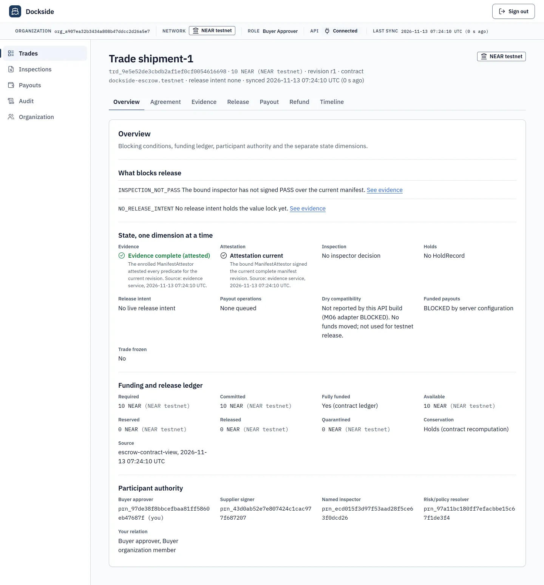
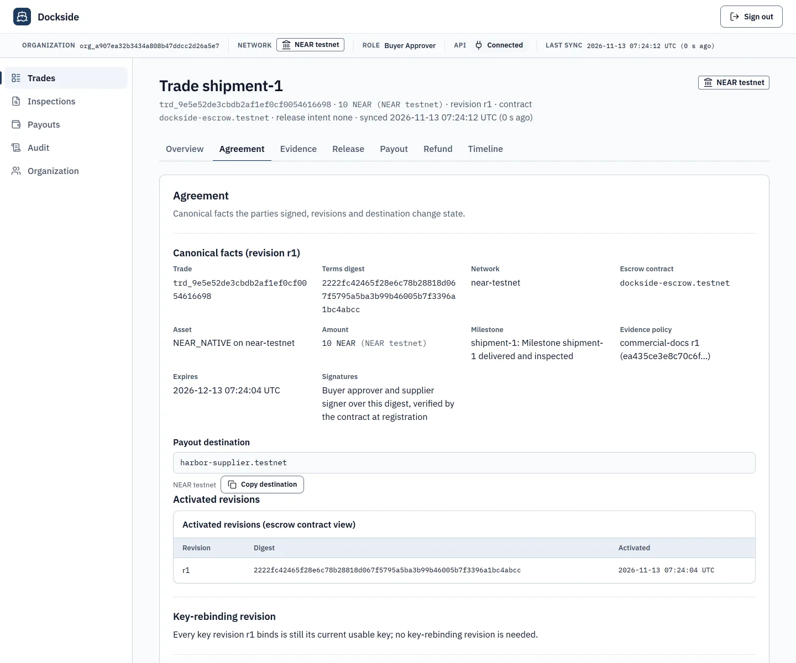
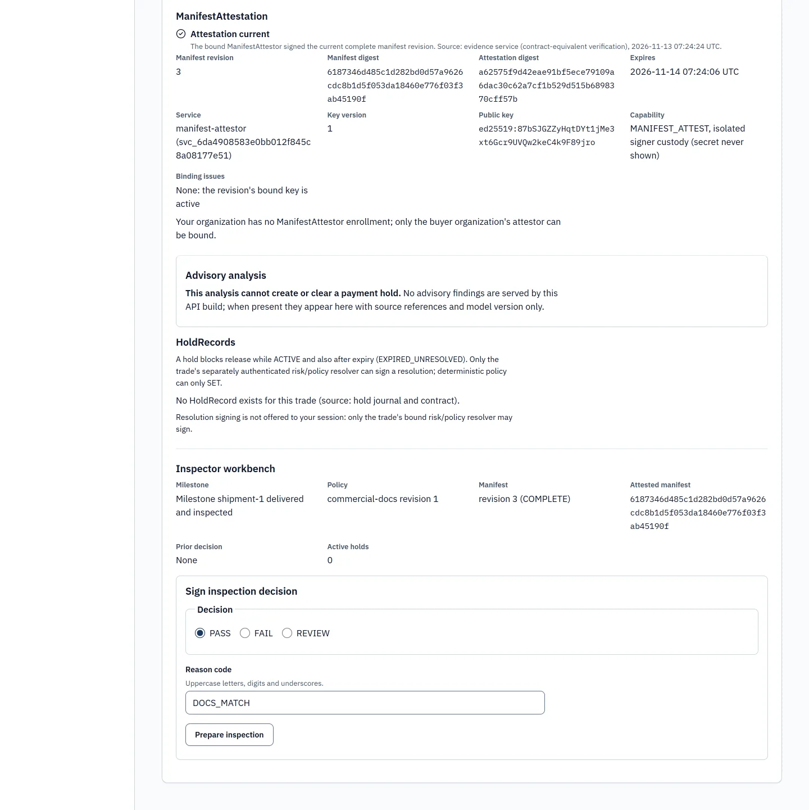
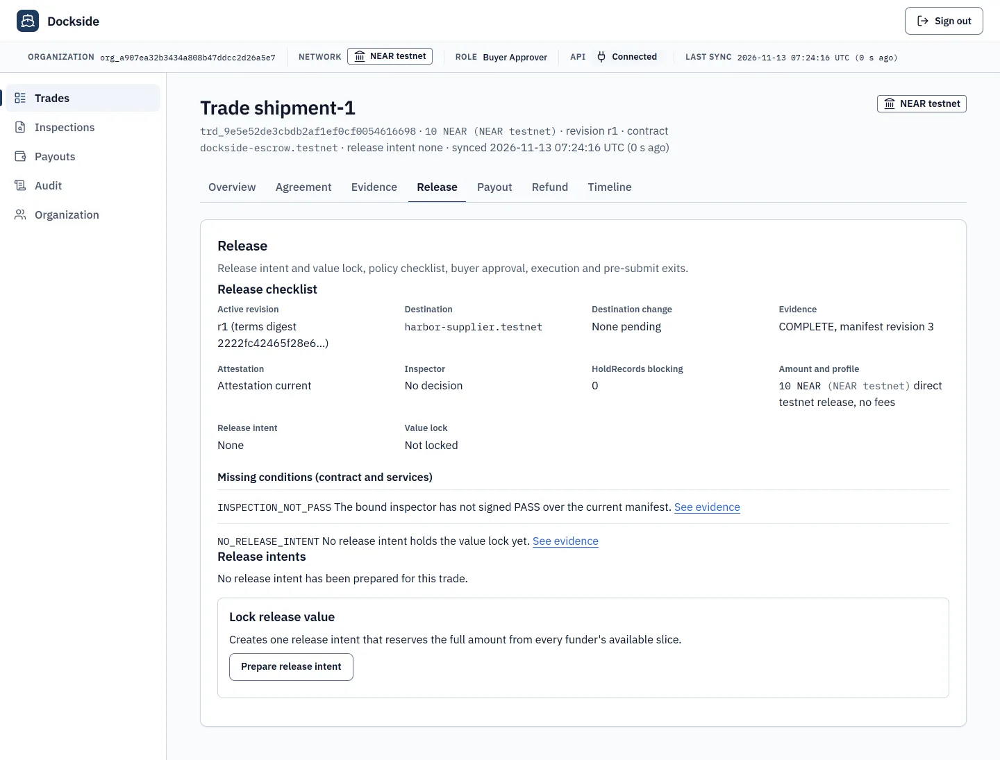

# Dockside

Trade-payment escrow on NEAR: the buyer's money (NEAR or USDC) is held by a NEAR contract and paid out only to the
supplier account both parties signed, only after the inspector's PASS and the buyer's approval, and refunds go only
back to whoever paid.

[](https://github.com/gnanam1990/dockside-near/actions/workflows/ci.yml)
[](LICENSE)

Demo video: **pending** (not recorded yet; it will follow [docs/demo/DEMO-SCRIPT.md](docs/demo/DEMO-SCRIPT.md)).
Until the video, the proof page and a hosted app are live, there is **nothing to open without installing**: the
fastest checks are the one-line `get_ledger` call below (no install) and `pnpm judge` (one command).

- **Proof page** (reads NEAR live in your browser, no install): https://gnanam1990.github.io/dockside-near/ —
  published after the Pages workflow runs ([`.github/workflows/pages.yml`](.github/workflows/pages.yml); not live
  yet). Payment receipt:
  https://gnanam1990.github.io/dockside-near/receipt.html?trade=trd_197c633d724eeb2cddc64d6dabf55976 (same
  condition). Until then, `pnpm proof:serve` serves the same page locally ([M46](docs/status/M46.md)). The page
  re-checks the native-NEAR escrow2; the USDC escrow3 is re-checked by `pnpm judge` (below), not by the page yet.
- **Hosted app:** pending (the container is built and verified locally, [M55](docs/status/M55.md); not deployed).
- Architecture and every developer command: [docs/ARCHITECTURE.md](docs/ARCHITECTURE.md). Item-by-item status:
  [BUILD-STATUS.md](BUILD-STATUS.md).

## 30-second summary

- **Problem.** Trade payments go wrong in three ordinary ways: the payout account is swapped at the last moment (a
  "new bank details" email), money is released before the goods are inspected, and refunds go to whoever asks
  instead of to whoever paid.
- **What Dockside does.** Buyer and supplier sign one agreement that fixes the payout account, the evidence the trade
  needs, the inspector and a separate risk resolver. The escrow contract pays out only to that account, only when the
  evidence is attested, the inspector signed PASS, no hold is active and the buyer approved that exact state.
  Changing the payout account needs both signatures and a delay. Refunds go only to the original funder. The app
  shows PAID or REFUNDED only after reading the chain receipts.
- **Why NEAR.** The contract checks every party's Ed25519 signature itself (`env::ed25519_verify`), so the relayer
  that submits transactions cannot act for a party. Function-call access keys let a relayer pay gas without being
  able to move money. NEP-141 lets the same escrow hold USDC. Settlement callbacks see whether a transfer really
  happened before the trade is marked paid.

## Screenshots

These come from the local app over a **simulated** NEAR chain (the app itself has not run against testnet; see
[Honest status](#honest-status)).









## See it on chain (NEAR testnet)

Six recorded journeys on two escrows, all run by the repository owner with `scripts/testnet-deploy/run-all`. Every
transaction below was re-read at `finality: final` through `https://test.rpc.fastnear.com` and is final and
successful, except the refusals, which fail with exactly the expected code
([M34](docs/status/M34.md), [M44](docs/status/M44.md), [M56](docs/status/M56.md)).

| Escrow | Asset | Code hash (equals the reproducible build manifest) | Deploy + `new` |
|---|---|---|---|
| [`gnanam1990-dock-escrow3.testnet`](https://testnet.nearblocks.io/address/gnanam1990-dock-escrow3.testnet) | Circle testnet USDC ([`3e2210e1…b8af`](https://testnet.nearblocks.io/address/3e2210e1184b45b64c8a434c0a7e7b23cc04ea7eb7a6c3c32520d03d4afcb8af)) | `ACFe6Us2mTm8ms2VYgC1PTG4VrMmMHzNhT99tcxk2sq` (audited M50 build, wasm SHA-256 `025af34e…7770`) | [6PfiGs1m…JgoR](https://testnet.nearblocks.io/txns/6PfiGs1mhovxnESPSbjzvMAAz1VoFpKuipee7bxkJgoR) |
| [`gnanam1990-dock-escrow2.testnet`](https://testnet.nearblocks.io/address/gnanam1990-dock-escrow2.testnet) | native NEAR | `7GEti5E6NWcjq8kHj5Gweed5HwggY1cxPD7cfbB65h8N` (security-hardened build `4ff233b`) | [7TZqFwwK…akkA](https://testnet.nearblocks.io/txns/7TZqFwwKH9NKohDRS5RBfudep8hmwxeJoiNE18WdakkA) |

### USDC on escrow3 ([M56](docs/status/M56.md), evidence [docs/evidence/M56/](docs/evidence/M56/))

| Journey | Trade | Funding (buyer's own key) | Key step | Payout |
|---|---|---|---|---|
| Paid | `trd_7b76…1f2f` | [`ft_transfer_call` 5 USDC](https://testnet.nearblocks.io/txns/2gzs2r79EhfGhTVCVxHHKPmdRUxRTShmBwBBJJCiCHY1) | [inspection PASS](https://testnet.nearblocks.io/txns/9iUmGixdHaSUQzqUyp3EiGDts19avxHLquxuRAE9cQ7B), [approval](https://testnet.nearblocks.io/txns/CAE1EjKSgReY48dKVQouHYwEozCyJSJEJHM1RaexWndq) | [`execute_release`: `ft_transfer` of exactly 5 USDC to the supplier](https://testnet.nearblocks.io/txns/ANyGBfVTpUzjTdMdVZcP2RSnSewzYCRHR97A2Z51CX1B) |
| Hold | `trd_9656…5a77` | [5 USDC](https://testnet.nearblocks.io/txns/GGReYME6Ha8mAagWvm7NicTTAWdKrUSP6WtzHqSsYgSh) | [`set_hold` DOC_MISMATCH](https://testnet.nearblocks.io/txns/2oxiNqeDRYnEEyTBuLfQar4M21fu5Hv2mpYet1NMbZyL) blocks release; [`resolve_hold` by the risk resolver](https://testnet.nearblocks.io/txns/JDZy69FzLWaqAxUXhLghoHUGWPBpnsHAgwvtxm22TrK1) | [exactly 5 USDC to the supplier](https://testnet.nearblocks.io/txns/FD7izvtEY76ir6nfYYsVcqmtmPhoCtsdwQwmrMsFKa1U) |
| Refusal | `trd_e93f…1e71` | [2.5](https://testnet.nearblocks.io/txns/72YHkefZekpTDhTn9VLGVoTcvRkS6jLkQ3t3YPhXQbm3) + [2.5 USDC](https://testnet.nearblocks.io/txns/8roKKkeHSHvd1XnVBGSvKvSyM3m1VsGN8m14QQBCf7L9) | six refused calls (next table) | [exactly 5 USDC to the supplier](https://testnet.nearblocks.io/txns/BZ9Ey8dMzmcQfrMvFRBLUTnJXDA7dvmemQ5kuiiivCao) |
| Refund | `trd_dfea…8982` | [5 USDC (1 excess quarantined)](https://testnet.nearblocks.io/txns/GZZzML8uCt4dRfi3TyUva41J9CNC5gdVALvEvYoCRk29) | [`MUTUAL_CANCEL` signed by both](https://testnet.nearblocks.io/txns/FGahhC6FYu1UwvHh2YE52UW4koDC9zdtV3DrCs5oq323), one-hour cooling period | [4](https://testnet.nearblocks.io/txns/9X6ccU7QxAYrN5ySyTSQ8wkNxB3bQPic6cTpcQ3pn9Aj) + [1 USDC](https://testnet.nearblocks.io/txns/J4tcqMKfWxdTncqttvVgexdoagk9zYYe4WEwoqdfHwHR) back to the buyer; supplier nothing |

The six attacks the contract refused on testnet, each a real transaction:

| Attempt | Contract answer | Transaction |
|---|---|---|
| Fund with a wrong terms digest | `STALE_REVISION`; the token returned all 2.5 USDC in the same transaction | [4u9sbsZJ…qDBX](https://testnet.nearblocks.io/txns/4u9sbsZJecFijqPxNP4LL9yXZYkbFJgznCBxjRr1qDBX) |
| Relayer asks for a funder-only refund | `FORBIDDEN` | [qKB4NxwH…gzw](https://testnet.nearblocks.io/txns/qKB4NxwH4ZARn1kQgqkGXh3UQpzdoJcceVcvNvQbzgw) |
| Replay an accepted inspection | `NONCE_REPLAYED` | [HuR557dM…uegn](https://testnet.nearblocks.io/txns/HuR557dMzDP4jLKVzXw3rSWCDFJbHVuMz5vrSomLuegn) |
| Redirect the payout to an unbound account | `DESTINATION_MISMATCH` | [Dex2SQYE…m1Y](https://testnet.nearblocks.io/txns/Dex2SQYEgCFJDF3P61KuWLGmHA4xFngWSBkQ5YvGtm1Y) |
| Release while a hold is active | `HOLD_ACTIVE` | [9z68Gk7x…i5D3](https://testnet.nearblocks.io/txns/9z68Gk7xY17SVMLGGptiaRt7DbTx4JgY47ATRx2Zi5D3) |
| Approve with a key the agreement does not bind | `SIGNATURE_INVALID` | [5Eu7FQ2C…95gLN](https://testnet.nearblocks.io/txns/5Eu7FQ2CaGr9rqrxToCJEwmEsrtHMbij3CzijPj95gLN) |

After the four USDC journeys the supplier holds 15 USDC (3 × 5), the buyer has its 5 refunded USDC back, escrow3
holds 0, and USDC left escrow3 only in the three `execute_release` and two `execute_refund` calls ([onchain-reverify.json](docs/evidence/M56/onchain-reverify.json)).

### Native NEAR on escrow2 ([M34](docs/status/M34.md), [M44](docs/status/M44.md))

| Journey | Trade | Funding (buyer's own key) | Key step | Outcome |
|---|---|---|---|---|
| Paid | `trd_197c…5976` | [`fund` 0.05 NEAR](https://testnet.nearblocks.io/txns/74Mm1z1UZdJvgKfYUCjWF9FWzQhSYYzZ5yYk7LtAszAv) | [inspection PASS](https://testnet.nearblocks.io/txns/WQadd3x4Rx6a1mKzTfezVD7YT95fziFWmB9bkqeSNpz), [approval](https://testnet.nearblocks.io/txns/oGPmEVG8q2nGDQxj4hHDoUeCNm1BHZJdQdkKiVVTs6p) | [`execute_release`: exactly 0.05 NEAR to the supplier](https://testnet.nearblocks.io/txns/9Wpr243gsWkQuKFbtmBrKMiGkXCPXp3MDfN8M1qrkcEn) |
| Hold | `trd_75c1…f46f` | [0.05 NEAR](https://testnet.nearblocks.io/txns/7oT9cjuVZbKW7c7zzGxPAHF9NyKL7ezVz7GJmhguVtNW) | [`set_hold`](https://testnet.nearblocks.io/txns/6uGfXf4KkBcBoYQ2RrVKZB1kpUyd8GfFmrMVhGCrux3Y) (`HOLD_ACTIVE`), [`resolve_hold`](https://testnet.nearblocks.io/txns/4mLX4EEbcEm1sbhb7NPh8a7TJrrnu4tpo1MqxaeSbDHC) | [exactly 0.05 NEAR to the supplier](https://testnet.nearblocks.io/txns/2uSgWxtFqF5N9GRj5d7BR44B3xZnfy5ESjFh6KAKvGGf) |
| Refund | `trd_a549…9a2d` | [0.06 NEAR (0.01 excess quarantined)](https://testnet.nearblocks.io/txns/Ek1ChXhUX3nV7em6juGk98PtCAeJ9yusehPWYbWtoUZG) | [`MUTUAL_CANCEL` signed by both](https://testnet.nearblocks.io/txns/8MCwD4eXbvysFYeQ97kjzwm3wft6s1UxfKNdU4boTDa), one-hour cooling period | [0.05](https://testnet.nearblocks.io/txns/HWYQAKSP4rdwAunFhzmh2kgnZQnSmtmQJtn9vJ8yQSVG) + [0.01 NEAR](https://testnet.nearblocks.io/txns/H27cwCWsjYyZFYhCcXevtGQVxNRvW4gKjsNkdGsPby9T) back to the buyer; supplier nothing |

### Check it yourself (read-only, one line, no account)

```sh
curl -s https://test.rpc.fastnear.com -H 'Content-Type: application/json' -d '{"jsonrpc":"2.0","id":"1","method":"query","params":{"request_type":"call_function","finality":"final","account_id":"gnanam1990-dock-escrow3.testnet","method_name":"get_ledger","args_base64":"eyJ0cmFkZV9pZCI6InRyZF83Yjc2OTAwZTQxMWE1YmQ4YWZhZGNmMzIyYmRmMWYyZiJ9"}}' | node -e 'let s="";process.stdin.on("data",d=>s+=d).on("end",()=>console.log(Buffer.from(JSON.parse(s).result.result).toString()))'
```

You see the USDC paid trade's ledger: `"kind":"NEP141"`, `"funded":"5000000"`, `"released":"5000000"` (5 USDC,
6 decimals) from `gnanam1990-dock-buyer.testnet`, every other bucket `"0"`, and `"conservation":true`. The
`args_base64` value is `{"trade_id":"trd_7b76900e411a5bd8afadcf322bdf1f2f"}`; base64 any other trade id the same way,
and use `gnanam1990-dock-escrow2.testnet` for the native trades. PowerShell:

```powershell
$b='{"jsonrpc":"2.0","id":"1","method":"query","params":{"request_type":"call_function","finality":"final","account_id":"gnanam1990-dock-escrow3.testnet","method_name":"get_ledger","args_base64":"eyJ0cmFkZV9pZCI6InRyZF83Yjc2OTAwZTQxMWE1YmQ4YWZhZGNmMzIyYmRmMWYyZiJ9"}}'; [Text.Encoding]::UTF8.GetString([byte[]](Invoke-RestMethod -Method Post -Uri https://test.rpc.fastnear.com -ContentType 'application/json' -Body $b).result.result)
```

## Try it in 10 minutes

Needs Node 22 (`>=22.13 <23`), pnpm 10, git and Rust stable with the wasm target
(`rustup target add wasm32-unknown-unknown`). Checked for this README from a fresh clone of `main` on Windows 11
(Git Bash); CI runs the same on `ubuntu-24.04` and `windows-2022`. macOS was not tested.

1. **One command: `pnpm judge`** (about 3–6 minutes; measured 5 min on a fresh clone with a warm pnpm store).

   ```sh
   git clone https://github.com/gnanam1990/dockside-near.git && cd dockside-near
   pnpm judge
   ```

   It installs from the frozen lockfile, runs the unit and integration tests and the contract tests, checks that
   the proof manifest is derived from the committed evidence, re-checks the escrow2 deployment, its three trade
   ledgers and all 26 journey transactions on NEAR testnet, and re-checks the USDC escrow3 against
   [onchain-reverify.json](docs/evidence/M56/onchain-reverify.json): code hash, token config, relayer key, the 3
   setup and 45 journey transactions with every USDC payout, the 6 refusal codes, the 4 trade ledgers with
   conservation recomputed, and the supplier, buyer and escrow3 USDC balances at the evidence block (all read-only;
   it holds no key). Expected last line (the time depends on the machine):

   ```text
   JUDGE: PASS  90 passed, 0 failed, 0 not readable, 1 skipped, 5m 0s
   ```

   The table above it shows, for example, `901 passed, 0 failed in 91 files` (vitest), `141 passed, 0 failed in 24
   suites` (cargo) and every on-chain row with the expected value beside the actual one. The one SKIP is mainnet
   ("not deployed yet"). Full values go to `.data/judge/judge-report.json`. The two test steps take most of the
   time: unit tests about 80–110 s and contract tests about 100–180 s in our runs; the chain reads take about
   15 s. `pnpm judge --only chain,usdc` runs only the on-chain checks. `Ignored build scripts: esbuild` and
   `ExperimentalWarning: SQLite` lines are harmless.

2. **Watch the product run in a browser** (four separately enrolled users, simulated chain; about 3–5 minutes).

   ```sh
   pnpm --filter @dockside/web exec playwright install chromium
   pnpm run web:build
   pnpm --filter @dockside/web exec playwright test e2e/product.spec.ts
   ```

   Expected: `7 passed` (2.4 to 4.9 minutes in our runs, depending on the machine). The buyer proposes a trade and the supplier countersigns in another session, the
   evidence slots refuse bad content, a policy hold is SET and only the risk session can RESOLVE it, a lost outcome
   stays locked and never shows as paid, the trade reaches PAID and its signed receipt PDF verifies offline; no
   session token or evidence bytes reach the page, and accessibility checks run at four widths and in dark mode.
   The hold test is silent for about a minute while it moves the simulated clocks.

3. **Open the app yourself** (optional; simulated chain, loopback only, two terminals).

   ```sh
   DOCKSIDE_ORIGIN=http://127.0.0.1:4391 pnpm run stack                       # terminal 1
   DOCKSIDE_API_URL=http://127.0.0.1:8791 DOCKSIDE_RELAYER_URL=http://127.0.0.1:8792 \
     pnpm --filter @dockside/web exec vite preview --host 127.0.0.1 --port 4391  # terminal 2
   ```

   Terminal 1 prints `{"event":"stack.listening",…,"chain":"SIMULATED"}`; http://127.0.0.1:4391 shows the Trades
   page with a "NEAR testnet" badge and "Sign in required"; http://127.0.0.1:4391/readyz returns
   `{"ready":true,"schemaVersion":10,"network":"near-testnet","fundedPayouts":"BLOCKED"}`. PowerShell variants, the control port for invitations
   and the testnet run on your own accounts: [docs/ARCHITECTURE.md](docs/ARCHITECTURE.md#run-it-locally).

## Features

Each merged module, one line. "Owner" marks a step that needs the repository owner's keys and is not done.

- Canonical agreement and organisations, invitations, proof-of-possession sessions, NEP-413 NEAR account link — [M00](docs/status/M00.md), [M01](docs/status/M01.md), [M17](docs/status/M17.md)
- Escrow contract: funding, buckets, refunds to the original funder, ledger conservation — [M02](docs/status/M02.md), `contract/crates/dockside-escrow`
- Evidence policy, attested manifests, inspector PASS, policy holds that only the risk resolver clears — [M03](docs/status/M03.md)
- Release intent that locks exact value, buyer approval, two-signature delayed payout change — [M04](docs/status/M04.md), [M10](docs/status/M10.md)
- Durable journal and reconciler: nothing shows PAID before the chain receipt; survives process kills — [M05](docs/status/M05.md), [M15](docs/status/M15.md)
- Integrated HTTP API with signed per-request proofs and a checksummed, then signed, audit export — [M07](docs/status/M07.md), [M17](docs/status/M17.md)
- Web app for buyer, supplier, inspector and risk resolver; design system — [M08](docs/status/M08.md), [ADR-0026](docs/adr/0026-visual-design-system.md)
- Hardening, rate limits, end-to-end suites — [M09](docs/status/M09.md)
- Unexpected-asset recovery (a stray NEP-141 returns only to its proven sender after 72 h) — [M11](docs/status/M11.md)
- Key rotation, recovery and key-rebinding revisions — [M12](docs/status/M12.md), [M14](docs/status/M14.md)
- Escrow on a real local nearcore node and the `run-all` deploy-and-journey script — [M16](docs/status/M16.md)
- CI on two OSes plus a Linux container reproduction of the wasm — [M13](docs/status/M13.md), [M18](docs/status/M18.md)
- Reviewer kits — [docs/review-kits/](docs/review-kits/)
- Native NEAR journeys on testnet: paid, hold, refund — [M24](docs/status/M24.md), [M34](docs/status/M34.md), [M44](docs/status/M44.md)
- Relayer signer custody and the testnet product runtime (API and worker against testnet: owner, not run) — [M43](docs/status/M43.md), [runbook](docs/runbooks/testnet-product.md)
- Proof page and `pnpm judge` (GitHub Pages: owner, not enabled) — [M46](docs/status/M46.md)
- Refusal journey: six rejected calls, then PAID (ran in USDC on testnet; native run: owner) — [M47](docs/status/M47.md), [M56](docs/status/M56.md)
- USDC rail (NEP-141 trade asset) and a mainnet guard with caps; audited; all four journeys on testnet (mainnet: owner) — [M50](docs/status/M50.md), [M56](docs/status/M56.md)
- Supplier cash-out to another chain through NEAR Intents 1Click, dry quotes only (real cash-out: owner, not run) — [M52](docs/status/M52.md)
- "Try to steal this payment" attack console (testnet demo trade: owner, not run) — [M53](docs/status/M53.md), [runbook](docs/runbooks/attack-console.md)
- Verifiable payment receipt page and signed PDF with an offline verifier — [M54](docs/status/M54.md)
- Hosted runtime: one container for API, worker and web (host deployment: owner) — [M55](docs/status/M55.md), [runbook](docs/runbooks/hosted-deploy.md)

## NEAR integration

- **Own escrow contract** in Rust, `near-sdk` 5.30.1 (`contract/crates/dockside-escrow`), on testnet at escrow2
  (native NEAR) and escrow3 (USDC).
- **Native NEAR**: payable `fund`; `execute_release` / `execute_refund` send `Promise::transfer` and settle in a
  private callback, so a refunded transfer returns to the reservation.
- **NEP-141 (USDC)**: funding by the funder's own `ft_transfer_call` with the trade id and terms digest in `msg`
  (`ft_on_transfer`; anything refused is returned in the same transaction); payout by `ft_transfer` with a settlement
  callback; `check_payee_storage` confirms the supplier is registered with the token before value is locked.
  NEP-171 and NEP-245 deposits are recorded and never credited.
- **On-chain signature checks**: every party and service payload is verified with `env::ed25519_verify` against keys
  bound in the agreement.
- **Function-call access keys**: the relayer key is restricted to the escrow contract and cannot transfer funds:
  a function-call key cannot attach a deposit, so it cannot fund a trade or send NEAR. Its method list is empty
  (any escrow method), on purpose: each escrow method either verifies a party's or service's Ed25519 signature on
  chain, or checks the calling account (a funder-only refund refuses the relayer with `FORBIDDEN`, as the USDC
  refusal journey shows), or is open to anyone by design and only carries out what the recorded, signed state
  already allows (`execute_release`, `execute_refund`, `check_payee_storage`, for example), paying only the bound
  destination or the original funder. A narrower
  method list would limit a leaked key's gas spending, not what it can authorize; changing it needs a new key on
  chain (owner, not done). `pnpm judge` checks the key's receiver on both escrows.
- **NEP-413** signed messages plus `view_access_key` to link a NEAR account to a user.
- **NEAR JSON-RPC** through the repository's own client (`packages/near`), default `https://test.rpc.fastnear.com`.
- **NEAR Intents 1Click**: dry quotes and status tracking for the supplier's cash-out (M52); no real swap run.
- **Tooling**: near-cli-rs 0.31 for deployment; near-sandbox 2.14.0 and near-workspaces in the test suites.

Not used: Chain Signatures, meta transactions. Mainnet: not deployed.

## Security

Two audits were run **by the team itself, not by third parties**. Every finding was treated as a claim: first
reproduced on the real code with a failing test, then fixed, and that test now passes. Every confirmed finding is
fixed, and both deployed contracts include the contract fixes.

- **[Strix](https://github.com/usestrix/strix) 1.7.0** (open-source automated penetration-testing agent), four
  findings: [vuln-0001](docs/status/SEC-dockside-vuln-0001.md) build-manifest argument injection,
  [vuln-0002](docs/status/SEC-dockside-vuln-0002.md) unpinned toolchain bootstrap,
  [vuln-0003](docs/status/SEC-dockside-vuln-0003.md) PDF filter hidden in a nested dictionary,
  [vuln-0004](docs/status/SEC-dockside-vuln-0004.md) rate-limiter table exhaustion.
- **Cloudflare's security-audit skill methodology**
  ([github.com/cloudflare/security-audit-skill](https://github.com/cloudflare/security-audit-skill)), applied by the
  team: [m25](docs/status/SEC-dockside-m25-pdf-regex-redos.md) PDF regex ReDoS,
  [m26](docs/status/SEC-dockside-m26-unavailable-read-not-pending.md) unavailable read opened a false incident,
  [m27](docs/status/SEC-dockside-m27-recovery-key-revocation.md) revoked recovery key resurrected,
  [m28](docs/status/SEC-dockside-m28-asset-queue-poison.md) asset recovery queue poisoning,
  [m29](docs/status/SEC-dockside-m29-toolchain-volume-verification.md) reused toolchain volumes,
  [m30](docs/status/SEC-dockside-m30-export-masking-and-idempotency-secret.md) export masking and stored invitation
  secret, [m31](docs/status/SEC-dockside-m31-rebinding-consent-integrity.md) key-rebinding takeover and consent
  replay, [m32](docs/status/SEC-dockside-m32-hold-liveness-and-funding-binding.md) hold resolver liveness and
  deposits bound to the terms, [m33](docs/status/SEC-dockside-m33-contract-storage-bounds.md) contract storage
  bounds.
- **M50 USDC contract audit** (self-run, same rule): two medium findings fixed in `e335eda` (a stranger could grow a
  trade record without bound; settlement callback gas did not grow with the record), each with a test that failed
  before the fix; two low findings left open for the owner with their mitigation
  ([review packet](docs/status/M50-review-packet.md#independent-audit-2026-11-13)).

Each `docs/status/SEC-*.md` names the failing test, the fix and the commands. CI holds no secrets; nothing in the
repository signs with a real wallet. Kit for an independent review:
[docs/review-kits/security-review.md](docs/review-kits/security-review.md).

## Honest status

**Claim level: `IMPLEMENTED_UNVERIFIED`** (the project's own gate, [BUILD-STATUS.md](BUILD-STATUS.md)): the code
exists and the contract journeys ran on testnet, but the full real-product gate is not complete.

| What | Where it ran |
|---|---|
| Contract: paid, hold, refund journeys in native NEAR | **NEAR testnet**, escrow2 (M34, M44) |
| Contract: paid, hold, refusal and refund journeys in USDC | **NEAR testnet**, escrow3 (M56); **USDC rail PASS on testnet** |
| Contract: destination change, NEP-141 recovery, runtime-refunded transfer, the USDC rail | local nearcore node (near-sandbox) |
| API, worker, web app, four roles, audit export, receipts, cash-out | locally, against a **simulated** NEAR chain (worker relayer custody validated on a local nearcore node, M43) |
| Who signed on testnet | **one operator** for every role (keys derived from one seed); separate people on separate devices: not run |
| Hosted app, GitHub Pages proof page | built and verified locally; **not deployed** (the proof page covers escrow2; `pnpm judge` covers both escrows) |
| Demo video | **not recorded yet** (script: [docs/demo/DEMO-SCRIPT.md](docs/demo/DEMO-SCRIPT.md)) |
| Mainnet | **mainnet-ready, same audited contract, capped at 25 USDC per trade; deployment pending** |
| 1Click real quote and cash-out | not run (only dry quotes against a local simulator) |
| Manual accessibility review | not run (automated axe checks pass) |

What remains for `WORKING_TESTNET`: [docs/USER-NEXT-STEPS.md](docs/USER-NEXT-STEPS.md). The older escrow
`gnanam1990-dock-escrow.testnet` runs the pre-audit contract and is superseded ([M24](docs/status/M24.md)).

## Hackathon notes

- **Built at NEAR HACKATHON, 2026-11-11 to 2026-11-14.** Every commit is from 2026-11-11 or later; the first one
  imports the specification pack ([docs/spec/](docs/spec/START-HERE.md), no code).
- **Sibling project** by the same author, independent repository and code: **RouteSpec**,
  [github.com/gnanam1990/routespec-near](https://github.com/gnanam1990/routespec-near).
- **Libraries** (pinned in `pnpm-lock.yaml` and `contract/Cargo.lock`): near-sdk, React, Vite, Vitest, Playwright
  with axe-core, Biome, fast-check, lucide-react and Node's built-in `node:sqlite`; near-cli-rs, near-sandbox and
  near-workspaces for deployment and tests.
- Demo script: [docs/demo/DEMO-SCRIPT.md](docs/demo/DEMO-SCRIPT.md).

Development was AI-assisted (coding agents); all code was tested and reviewed in this repository.

## License

[MIT](LICENSE).
